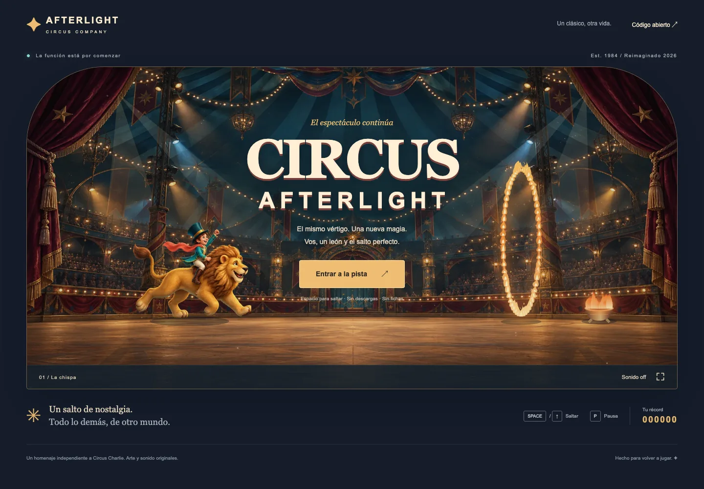

# Circus Afterlight ✦

**El mismo vértigo. Una nueva magia.** Un homenaje moderno e independiente a Circus Charlie, jugable directamente en el navegador.

[**Entrar a la pista**](https://circus-afterlight.jonymusky.com/)



Una carpa nocturna dibujada con Canvas, un pequeño artista sobre un león, aros de fuego, luces volumétricas y una banda sonora sintetizada. Tres actos de dificultad creciente, 24 obstáculos, tres vidas y combos por saltos precisos. Escenografía y sprites originales asistidos por IA, efectos visuales procedurales y audio sintetizado localmente: sin assets externos, cuentas, anuncios ni dependencias de producción.

## Jugar

- **Espacio / ↑ / W:** saltar. En celular, usá el botón **Saltar**.
- **P / Escape:** pausar o continuar. Cambiar de pestaña pausa automáticamente.
- **Sonido:** se activa manualmente; incluye melodía y efectos Web Audio.
- Saltá cerca de cada aro. Encadená saltos para multiplicar puntos hasta ×5.
- Completá los tres actos. Cada vida restante suma 1.000 puntos.
- El récord se guarda exclusivamente en tu dispositivo.

## Desarrollo

Node.js 22 o superior. No hace falta instalar paquetes.

```sh
npm run dev       # http://127.0.0.1:4173
npm test          # node:test: física, colisiones, progresión y partida completa
npm run check     # validación de sintaxis
npm run build     # genera dist/
```

## Arquitectura

| Archivo           | Responsabilidad                                                          |
| ----------------- | ------------------------------------------------------------------------ |
| `src/game.js`     | Simulación pura, independiente del DOM, con paso fijo a 120 Hz           |
| `src/renderer.js` | Canvas 2D, sprites animados, luces y partículas acotadas                 |
| `src/main.js`     | Inputs, estado de interfaz y persistencia tolerante a fallos             |
| `src/audio.js`    | Partitura original en 6/8, calliope, bajo, percusión, ambiente y efectos |
| `assets/`         | Escenografía y sprites WebP incluidos en el repositorio                  |
| `src/style.css`   | Interfaz adaptable, foco visible y movimiento reducido                   |
| `scripts/`        | Servidor local y build con módulos nativos de Node                       |

La simulación no depende de la tasa de refresco. El delta se limita al reanudar; el juego se pausa al perder foco. El canvas limita su densidad a 2×. El modo de movimiento reducido elimina partículas y movimiento ambiental. Los controles son botones HTML accesibles; el juego requiere percepción visual y coordinación, y no ofrece una modalidad equivalente para lectores de pantalla.

## Publicación

GitHub Pages, siguiendo el esquema de [Indicators](https://github.com/jonymusky/indicators). Cada push a `main` ejecuta checks, pruebas y build antes de publicar. Los pull requests sólo validan. Configurar **Settings → Pages → Source → GitHub Actions**. No requiere secretos ni backend. Todas las rutas de assets son relativas para funcionar bajo `/circus-afterlight/`.

## Alcance

Esta primera edición reinterpreta el número del león y los aros de fuego, con tres actos. No reproduce todos los niveles del juego original. El código, las ilustraciones procedurales y la música son originales. Circus Charlie pertenece a sus respectivos titulares; este proyecto no está afiliado ni respaldado por ellos.

## Contribuir

Ver [CONTRIBUTING.md](CONTRIBUTING.md). Código bajo licencia [MIT](LICENSE).

Arte, procedencia y prompts: [dirección de arte](docs/ART-DIRECTION.md). Evidencia de validación: [QA](docs/QA.md).

## Dominio e indexación

Dominio: `circus-afterlight.jonymusky.com`. CNAME DNS hacia `jonymusky.github.io`, sin proxy; GitHub Pages gestiona el certificado TLS y la redirección HTTPS. El build publica `CNAME`, `robots.txt` y `sitemap.xml`.

La portada entrega HTML estático con descripción y preguntas frecuentes, URL canónica, Open Graph, Twitter Card y JSON-LD `VideoGame`. Los metadatos usan únicamente datos verificables del juego. La imagen social vive en `assets/social-preview.jpg`. No se inventan reseñas ni puntuaciones.

Esto facilita el rastreo y la comprensión; no garantiza indexación, posiciones ni menciones en respuestas de IA. No se agregó `llms.txt`: [Google indica](https://developers.google.com/search/docs/fundamentals/ai-optimization-guide) que no aporta visibilidad en sus funciones de IA. La indexación y las métricas reales deberán comprobarse con Search Console; no se configuraron analítica ni tracking.
